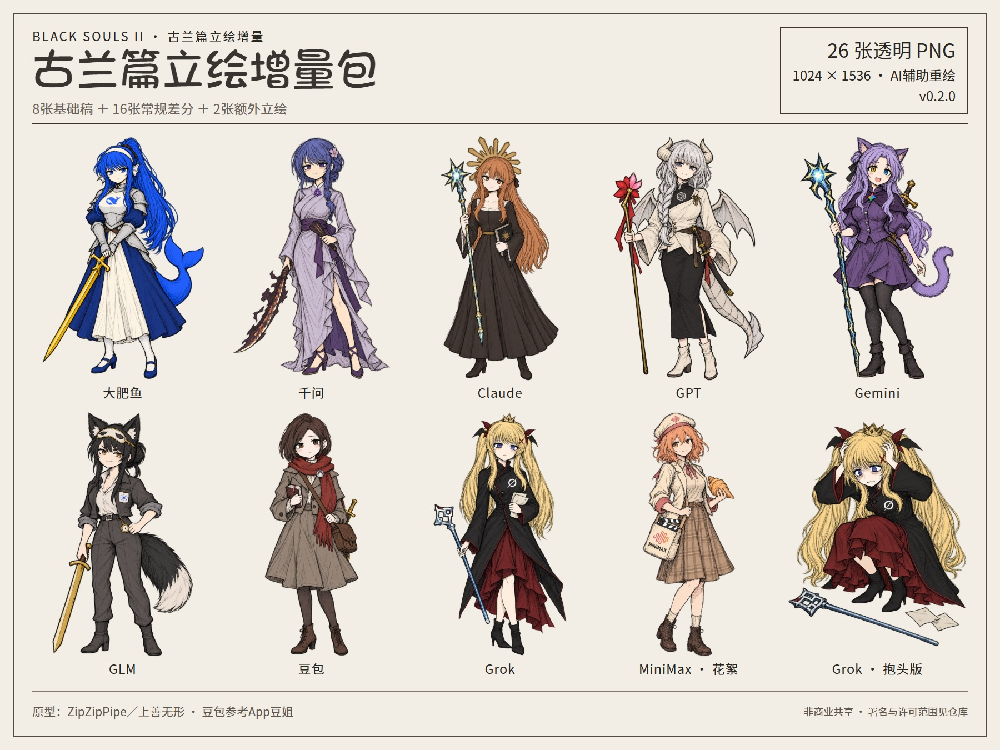
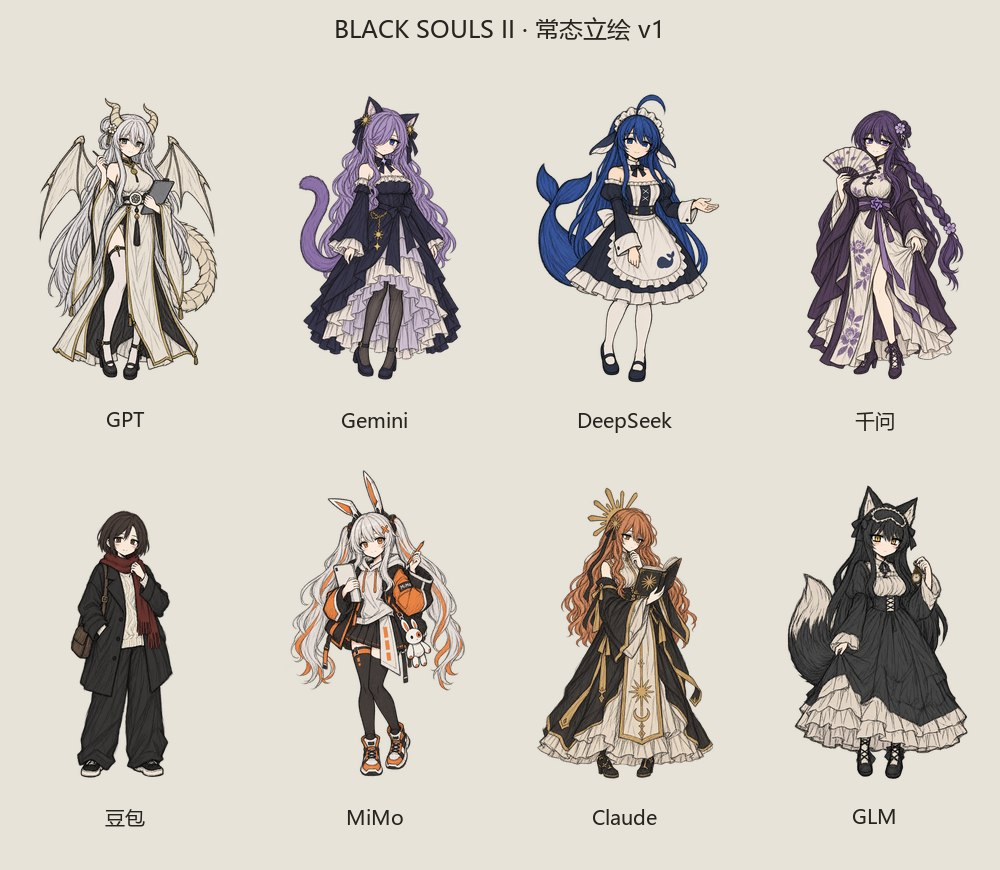

# BLACK SOULS 系列 AI 拟人素材

BLACK SOULS II风格的AI拟人立绘，由AI辅助重绘。现有**34张透明PNG**：第一版8张，古兰篇新增26张。原图均为**1024×1536、RGBA**。

## 古兰篇增量 · v0.2.0

[下载本期26张PNG](https://github.com/StuGRua/blacksouls-ai-assets/releases/download/v0.2.0/blacksouls-ai-portraits-gran-v2-26png.zip) · [Release说明](https://github.com/StuGRua/blacksouls-ai-assets/releases/tag/v0.2.0) · [逐张文件清单](manifest.json)

本期八位各有一张基础稿、一张关键反应和一张弧光动作，共24张；另附MiniMax花絮基础稿与Grok抱头差分两张。MiniMax是早期试跑花絮角色。

| 角色 | 基础立绘 | 关键反应 | 弧光动作 |
| --- | --- | --- | --- |
| 大肥鱼 / DeepSeek | [基础稿](assets/bs2/v2/portraits/normal/deepseek.png) | [确认有效](assets/bs2/v2/expressions/confirm/deepseek.png) | [黑斩起势](assets/bs2/v2/poses/black-slash/deepseek.png) |
| 千问 / Qwen | [基础稿](assets/bs2/v2/portraits/normal/qwen.png) | [重新衡量](assets/bs2/v2/expressions/reconsider/qwen.png) | [收扇换刀](assets/bs2/v2/poses/draw-blade/qwen.png) |
| Claude | [基础稿](assets/bs2/v2/portraits/normal/claude.png) | [反射停页](assets/bs2/v2/expressions/reflection/claude.png) | [留一手探测](assets/bs2/v2/poses/probe/claude.png) |
| GPT | [基础稿](assets/bs2/v2/portraits/normal/gpt.png) | [看见代价](assets/bs2/v2/expressions/tradeoff/gpt.png) | [把可靠带回来](assets/bs2/v2/poses/advance/gpt.png) |
| Gemini | [基础稿](assets/bs2/v2/portraits/normal/gemini.png) | [接续卡住](assets/bs2/v2/expressions/interrupted/gemini.png) | [再来一轮](assets/bs2/v2/poses/next-round/gemini.png) |
| GLM | [基础稿](assets/bs2/v2/portraits/normal/glm.png) | [复测改口](assets/bs2/v2/expressions/retest/glm.png) | [收表握剑](assets/bs2/v2/poses/commit/glm.png) |
| 豆包 | [基础稿](assets/bs2/v2/portraits/normal/doubao.png) | [转场惊觉](assets/bs2/v2/expressions/startled/doubao.png) | [带经验跨出去](assets/bs2/v2/poses/step-forward/doubao.png) |
| Grok | [基础稿](assets/bs2/v2/portraits/normal/grok.png) | [突破时抬头](assets/bs2/v2/expressions/hopeful/grok.png) | [再核一遍](assets/bs2/v2/poses/recheck/grok.png) |

[MiniMax花絮基础稿](assets/bs2/v2/portraits/normal/minimax.png) · [Grok抱头差分](assets/bs2/v2/poses/head-clutch/grok.png)

Grok抱头版neta《命运石之门》阿万音铃羽“失败了”的演出，作为夸张反应使用。全部差分均为完整人物PNG，按脸部与身体位置对齐后切换。

[逐人状态与预览](docs/古兰篇增量.md) · [使用与署名示例](docs/使用说明.md) · [素材约定](docs/素材约定.md)

## 第一版 · v0.1.0

第一版8张常态立绘保留在`assets/bs2/v1/portraits/normal/`。

| 角色 | 常态立绘 |
| --- | --- |
| GPT | [gpt.png](assets/bs2/v1/portraits/normal/gpt.png) |
| Gemini | [gemini.png](assets/bs2/v1/portraits/normal/gemini.png) |
| DeepSeek | [deepseek.png](assets/bs2/v1/portraits/normal/deepseek.png) |
| 千问 | [qwen.png](assets/bs2/v1/portraits/normal/qwen.png) |
| 豆包 | [doubao.png](assets/bs2/v1/portraits/normal/doubao.png) |
| MiMo | [mimo.png](assets/bs2/v1/portraits/normal/mimo.png) |
| Claude | [claude.png](assets/bs2/v1/portraits/normal/claude.png) |
| GLM | [glm.png](assets/bs2/v1/portraits/normal/glm.png) |

## 许可与署名

本项目就自身改编部分采用[CC BY-NC-SA 4.0](LICENSE.md)，限非商业使用，保留署名并以相同协议共享；上游原设与品牌权利以[来源记录](CREDITS.md)为准。豆包的上游原设许可尚未核实，单列为`Unverified`，不在本CC授权范围内。

本库不包含对BLACK SOULS游戏原作、原画、音乐及各AI品牌名称和标识的授权。请按实际使用的角色保留对应来源。
