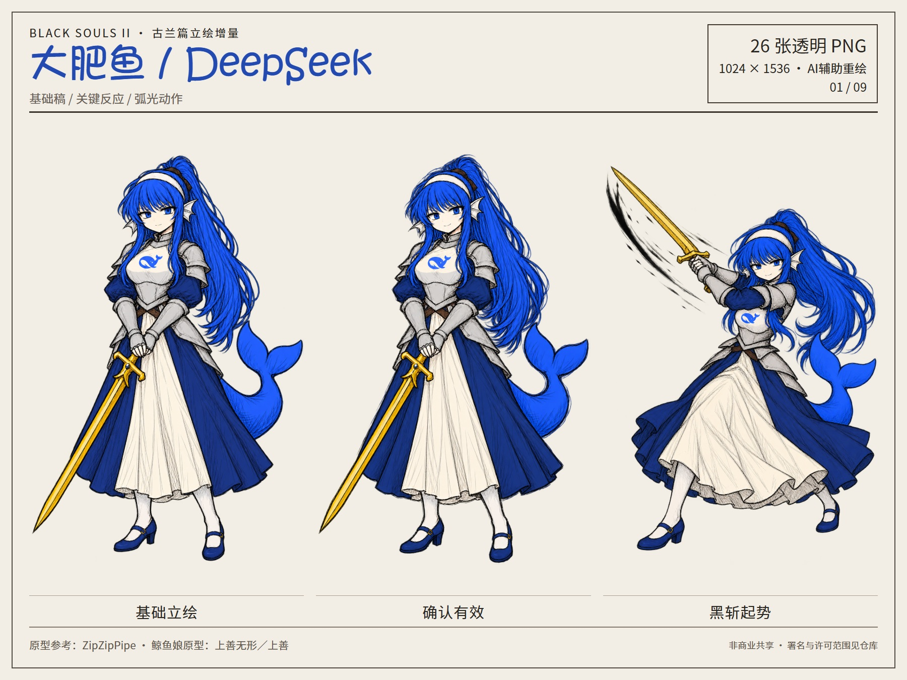
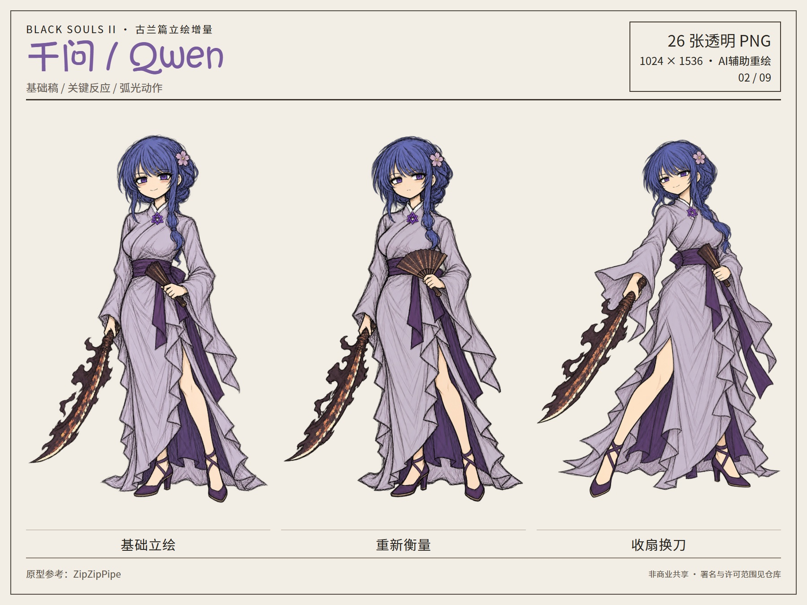
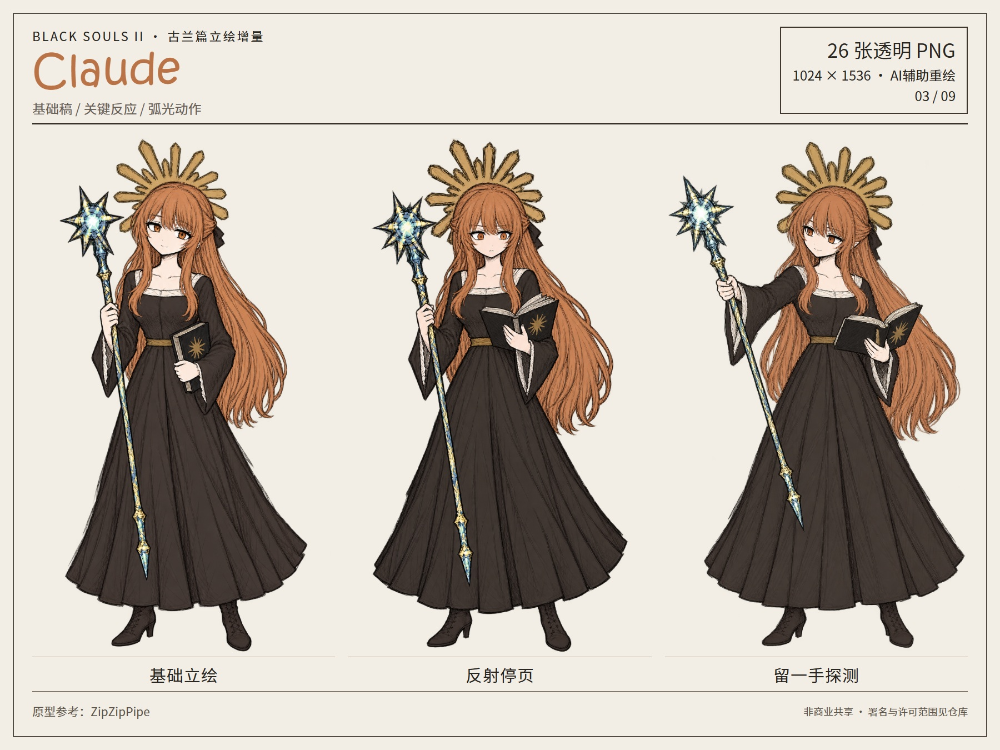
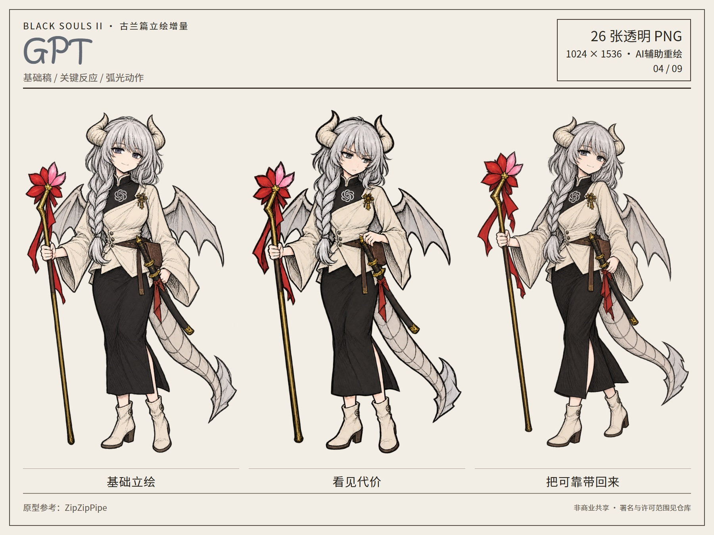
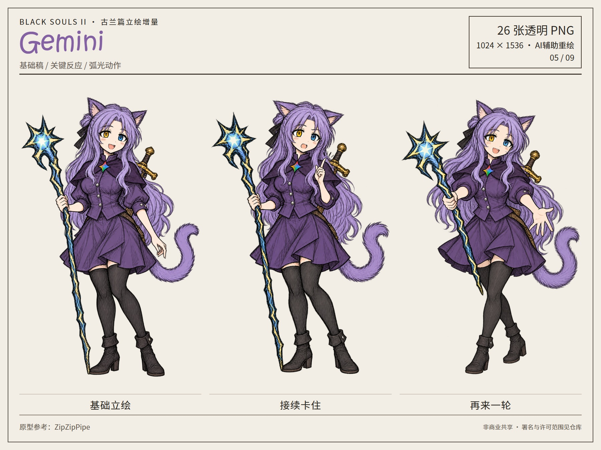
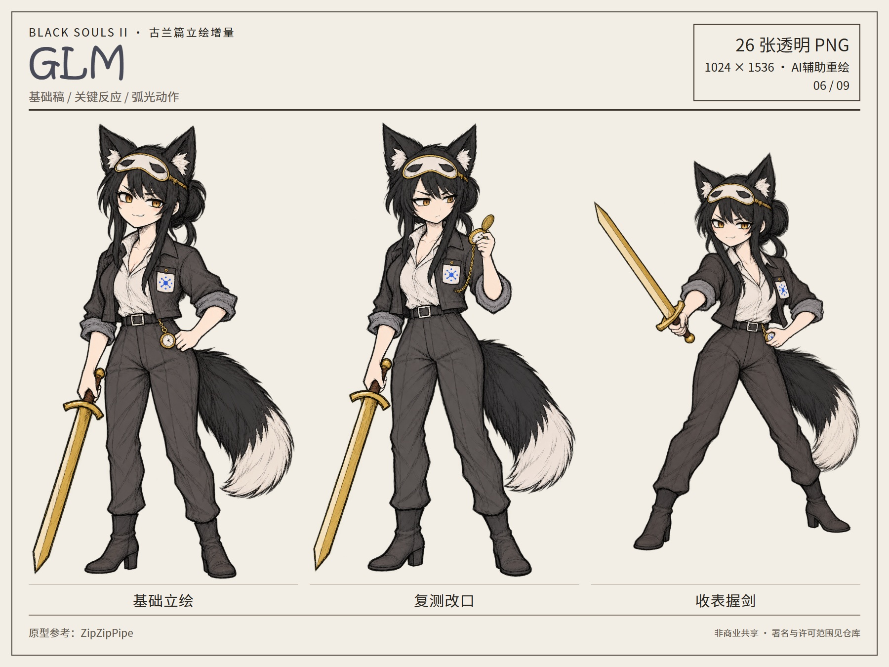
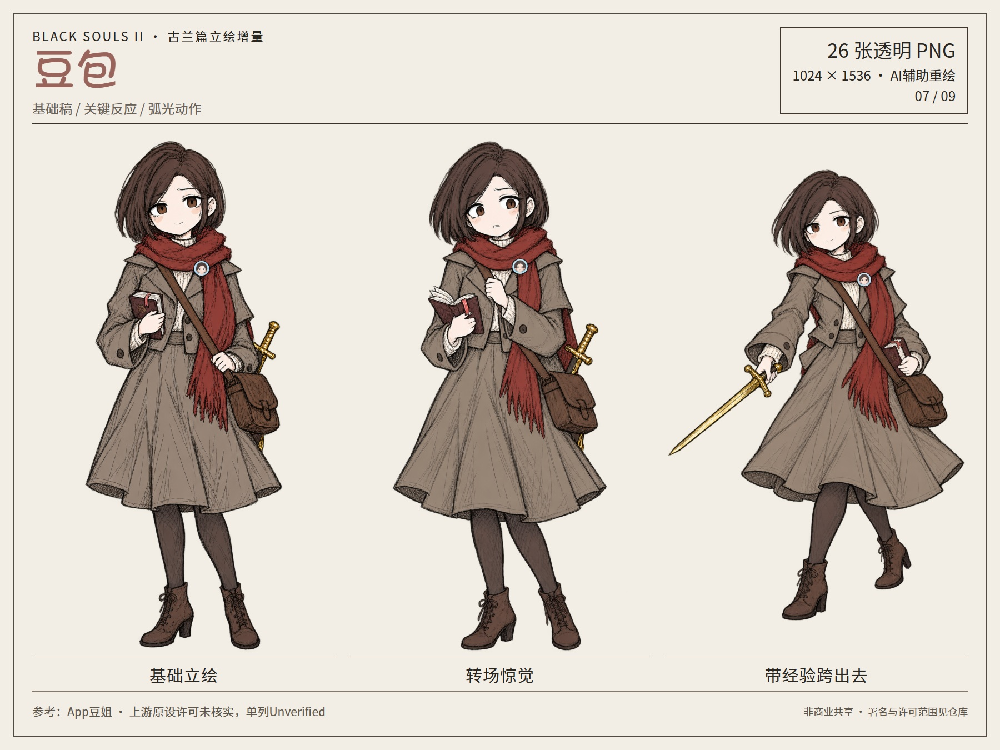
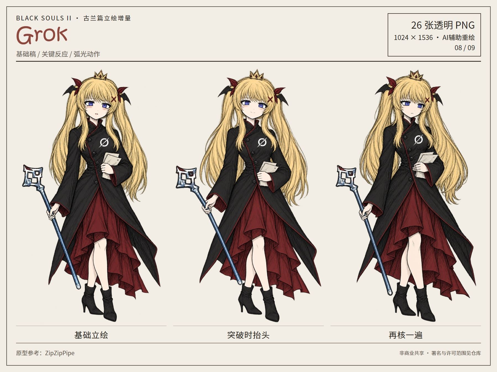
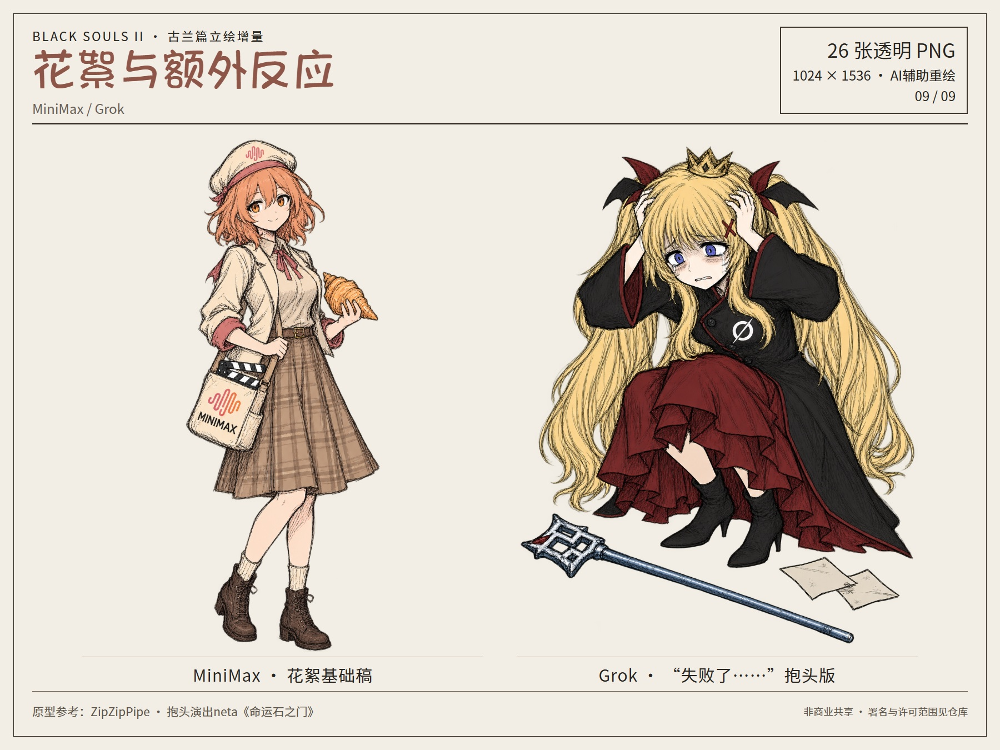

# 古兰篇立绘增量包

26张透明PNG：八位基础稿8张、关键反应8张、弧光动作8张，以及MiniMax花絮稿、Grok抱头版各1张。

| 角色 | 基础立绘 | 关键反应 | 弧光动作 |
| --- | --- | --- | --- |
| 大肥鱼 / DeepSeek | [基础稿](../assets/bs2/v2/portraits/normal/deepseek.png) | [确认有效](../assets/bs2/v2/expressions/confirm/deepseek.png) | [黑斩起势](../assets/bs2/v2/poses/black-slash/deepseek.png) |
| 千问 / Qwen | [基础稿](../assets/bs2/v2/portraits/normal/qwen.png) | [重新衡量](../assets/bs2/v2/expressions/reconsider/qwen.png) | [收扇换刀](../assets/bs2/v2/poses/draw-blade/qwen.png) |
| Claude | [基础稿](../assets/bs2/v2/portraits/normal/claude.png) | [反射停页](../assets/bs2/v2/expressions/reflection/claude.png) | [留一手探测](../assets/bs2/v2/poses/probe/claude.png) |
| GPT | [基础稿](../assets/bs2/v2/portraits/normal/gpt.png) | [看见代价](../assets/bs2/v2/expressions/tradeoff/gpt.png) | [把可靠带回来](../assets/bs2/v2/poses/advance/gpt.png) |
| Gemini | [基础稿](../assets/bs2/v2/portraits/normal/gemini.png) | [接续卡住](../assets/bs2/v2/expressions/interrupted/gemini.png) | [再来一轮](../assets/bs2/v2/poses/next-round/gemini.png) |
| GLM | [基础稿](../assets/bs2/v2/portraits/normal/glm.png) | [复测改口](../assets/bs2/v2/expressions/retest/glm.png) | [收表握剑](../assets/bs2/v2/poses/commit/glm.png) |
| 豆包 | [基础稿](../assets/bs2/v2/portraits/normal/doubao.png) | [转场惊觉](../assets/bs2/v2/expressions/startled/doubao.png) | [带经验跨出去](../assets/bs2/v2/poses/step-forward/doubao.png) |
| Grok | [基础稿](../assets/bs2/v2/portraits/normal/grok.png) | [突破时抬头](../assets/bs2/v2/expressions/hopeful/grok.png) | [再核一遍](../assets/bs2/v2/poses/recheck/grok.png) |

[MiniMax花絮基础稿](../assets/bs2/v2/portraits/normal/minimax.png) · [Grok抱头差分](../assets/bs2/v2/poses/head-clutch/grok.png)

## 逐人预览

### 大肥鱼 / DeepSeek

### 千问 / Qwen

### Claude

### GPT

### Gemini

### GLM

### 豆包

### Grok

### 花絮与额外反应

[使用与署名](使用说明.md) · [许可](../LICENSE.md)
