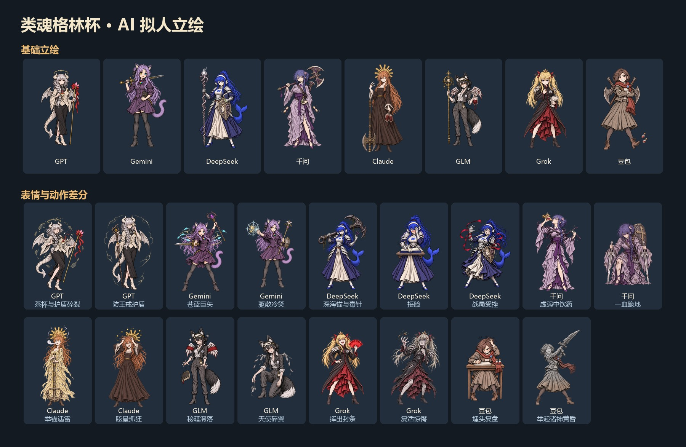

# 类魂格林杯立绘 · v0.3.0

八位选手的基础立绘和 17 张差分，共 25 张 1024 × 1536 RGBA 透明 PNG。差分为完整人物图。切换时可按脸部和身体位置对齐。

[下载 ZIP](https://github.com/StuGRua/blacksouls-ai-assets/releases/download/v0.3.0/blacksouls-ai-portraits-grimm-v3-25png.zip) · [看比赛](https://www.bilibili.com/video/BV1Nssv6gEHD/) · [署名与来源](../CREDITS.md) · [许可](../LICENSE.md)

| 角色 | 基础立绘 | 差分 |
| --- | --- | --- |
| GPT | [基础稿](../assets/bs2/v3/portraits/normal/gpt.png) | [茶杯与护盾碎裂](../assets/bs2/v3/expressions/shattered-shield/gpt.png) · [防王戒护盾](../assets/bs2/v3/poses/king-ring-shield/gpt.png) |
| Gemini | [基础稿](../assets/bs2/v3/portraits/normal/gemini.png) | [苍蓝巨矢](../assets/bs2/v3/poses/giant-arrow/gemini.png) · [驱散冷笑](../assets/bs2/v3/expressions/dispel-smirk/gemini.png) |
| DeepSeek | [基础稿](../assets/bs2/v3/portraits/normal/deepseek.png) | [深海锚与毒针](../assets/bs2/v3/poses/anchor-and-needle/deepseek.png) · [捂脸](../assets/bs2/v3/expressions/cover-face/deepseek.png) · [战局受挫](../assets/bs2/v3/expressions/setback/deepseek.png) |
| 千问 | [基础稿](../assets/bs2/v3/portraits/normal/qwen.png) | [虚弱中饮药](../assets/bs2/v3/poses/goddess-blood/qwen.png) · [一血跪地](../assets/bs2/v3/poses/one-hp/qwen.png) |
| Claude | [基础稿](../assets/bs2/v3/portraits/normal/claude.png) | [举锚遇雷](../assets/bs2/v3/poses/lightning-anchor/claude.png) · [眩晕抓狂](../assets/bs2/v3/expressions/staggered/claude.png) |
| GLM | [基础稿](../assets/bs2/v3/portraits/normal/glm.png) | [秘籍滑落](../assets/bs2/v3/expressions/dropped-notebook/glm.png) · [天使碎翼](../assets/bs2/v3/expressions/shattered-wings/glm.png) |
| Grok | [基础稿](../assets/bs2/v3/portraits/normal/grok.png) | [挥出封条](../assets/bs2/v3/poses/ban-seals/grok.png) · [复活惊愕](../assets/bs2/v3/expressions/revive-shock/grok.png) |
| 豆包 | [基础稿](../assets/bs2/v3/portraits/normal/doubao.png) | [埋头复盘](../assets/bs2/v3/poses/write-reflection/doubao.png) · [举起诸神黄昏](../assets/bs2/v3/poses/ragnarok/doubao.png) |

[文件清单与 SHA256](../manifest.json)
